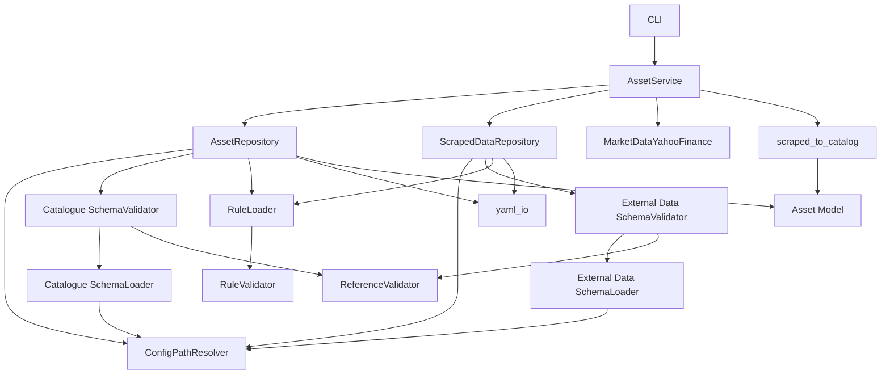

# Technical Architecture — Asset Management

## 1. General Principles

Patrimonia is designed around a clear separation between reference data, external data, application services and technical infrastructure.

The main architectural principles are:

- **Reference catalogue**: the catalogue is the internal reference source for asset definitions and related reference information.
- **External data separation**: data collected from external providers is stored separately from the reference catalogue.
- **Explicit catalogue enrichment**: fetching external data never modifies the catalogue directly. Integrating external information into the catalogue is an explicit operation.
- **Centralized configuration**: resource locations and storage conventions are defined centrally in `config_app.yaml`.
- **External data contracts**: JSON Schema defines the structural contracts of persisted data.
- **Internal data models**: Pydantic models represent the typed objects manipulated by the application.
- **Repository responsibility**: repositories encapsulate data access, validation and persistence.
- **Adapter responsibility**: adapters isolate communication with external providers and technical integrations.
- **Separation of concerns**: cross-cutting technical components remain independent of business use cases.
- **Dependency injection**: the bootstrap layer centralizes component construction and dependency injection.

These principles aim to keep business logic independent of storage formats, external providers and infrastructure details.

## 2. Responsibilities by Component

### 2.1. Application Layer — Services

Application services orchestrate use cases. They coordinate the components required to execute an operation without implementing low-level technical details.

#### AssetService

Location: `services/assets/asset_service.py`

`AssetService` coordinates asset-related use cases.

Its responsibilities include:

- Loading assets from the reference catalogue.
- Displaying asset information.
- Triggering the collection of external data (`fetch`).
- Triggering the integration of external information into the catalogue (`enrich`).
- Coordinating the repositories, adapters and transformations required by these operations.

Its dependencies are injected by the bootstrap layer.

`AssetService` must not:

- Construct storage paths directly.
- Read or write YAML files directly.
- Know the physical organization of schema or rule directories.
- Implement provider-specific collection logic.
- Mix external data collection with catalogue modification.
- Instantiate its own technical dependencies.

Fetching and enriching are two distinct operations:

- `fetch_market_data()` collects external market data and stores the result separately from the catalogue.
- `enrich_market_data()` integrates previously collected and validated information into the catalogue.

The separation ensures that collecting external information cannot silently alter reference data.

### 2.2. Validation Layer

Validation is implemented through specialized components coordinated by the relevant repository.

The validation process distinguishes between structural validation, business-rule validation, reference validation and construction of internal application models.

#### SchemaLoader

`SchemaLoader` is responsible for loading JSON Schemas required by the application.

Its responsibilities include:

- Resolving schema directories from the application configuration.
- Loading the schemas associated with a resource.
- Loading shared schemas required by `$ref` resolution.
- Building the schema registry.
- Providing the loaded schemas to schema validators.

The loading of shared schemas belongs to `SchemaLoader`, because it is responsible for the technical dependencies between schemas.

Application services and repositories should not have to resolve or pass individual shared-schema directories to the validator.

#### SchemaValidator

`SchemaValidator` validates data against the loaded JSON Schemas.

Its responsibilities include:

- Checking the structure of input data.
- Applying structural constraints defined in the schemas.
- Reporting schema validation errors.

It is used by repositories as part of their data-loading and validation workflows.

#### RuleLoader and RuleValidator

Business rules are handled separately from JSON Schema validation.

`RuleLoader` loads the business-rule definitions associated with a resource, including inherited rules where applicable.

`RuleValidator` evaluates these rules against the data and reports business constraint violations.

Business rules are evaluated only after structural validation succeeds.

This separation keeps structural contracts independent of domain-specific validation logic.

#### ReferenceValidator

`ReferenceValidator` handles validation that depends on external reference data.

Its responsibilities include:

- Loading the required reference catalogues.
- Checking the consistency of references used by the data being validated.
- Centralizing validation logic that depends on reference data.

Reference data should be loaded once where possible and reused by the relevant validators.

#### JSON Schema and Pydantic: Complementary Responsibilities

Patrimonia uses JSON Schema and Pydantic for different purposes.

**JSON Schema — persisted data contract**

JSON Schemas define the expected structure of persisted data.

They are used to check:

- Required fields.
- Data types.
- Structural constraints.
- Compliance with the expected data format.
- Schema-level references and constraints.

JSON Schema defines the structural contract at the boundary between persisted data and the application.

**Business rules — domain constraints**

Business rules define additional constraints that cannot be expressed conveniently or clearly through structural schemas alone.

They complement JSON Schema by checking domain-specific conditions.

**Pydantic — internal application model**

Pydantic models represent the typed Python objects manipulated by services and other application components.

They provide:

- Typed data structures.
- A consistent object representation.
- Attribute access through Python notation.
- Model construction and serialization.
- Additional validation during model construction.

Pydantic models are not necessarily direct copies of JSON Schemas. They may also contain computed properties and methods useful to the application.

The fundamental distinction is:

- JSON Schema validates the structure of persisted data.
- Business rules validate domain-specific constraints.
- Pydantic provides the typed internal representation used by the application.

#### Repository-Orchestrated Validation

The repository coordinates the validation pipeline when loading catalogue data.

The general sequence is:

1. Load the YAML data and resolve inheritance where applicable.
2. Validate the resulting data against its JSON Schema.
3. Evaluate the associated business rules.
4. Construct the corresponding Pydantic model.

The specialized loaders and validators perform their respective tasks. The repository coordinates them as part of a single loading workflow.

This avoids duplicating validation logic across application services and other components.

### 2.3. Configuration and Path Resolution Layer

#### ConfigPathResolver

Location: `config/paths_resolver.py`

`ConfigPathResolver` centralizes the resolution of application resource paths.

Its responsibilities include:

- Reading the relevant path configuration from `config_app.yaml`.
- Resolving paths relative to `app.base_dir`.
- Resolving resources from their logical configuration keys.
- Interpolating variables in directory paths and filenames.
- Providing paths to directories, schemas, rules and other configured resources.

It provides generic path-resolution operations, including:

- `resolve_resources()`: resolves the configured paths associated with a resource.
- `resolve_directory()`: resolves a directory path.
- `resolve_filename()`: generates a filename from the configured pattern.
- `resolve_file_path()`: resolves a complete file path.

Path resolution remains generic within `ConfigPathResolver`.

The consuming component is responsible for determining the business information required to build the resolution context.

For example, `AssetRepository` determines an asset's category-relative path through `get_category_path()`. Knowledge of the catalogue hierarchy belongs to the repository, not to the generic path resolver.

This separation prevents the configuration layer from depending on business-specific catalogue structures.

### 2.4. Catalogue Persistence Layer

#### AssetRepository

Location: `repositories/asset_repository.py`

`AssetRepository` is responsible for accessing and persisting asset definitions in the reference catalogue.

Its responsibilities include:

- Locating asset implementation files.
- Resolving paths from an asset identifier and category.
- Reading YAML asset definitions.
- Resolving category inheritance.
- Coordinating the catalogue validation pipeline.
- Constructing Pydantic `Asset` models from validated data.
- Saving asset definitions to the catalogue.
- Listing asset identifiers and loading individual assets.
- Providing the category-relative path of an asset.

The reference catalogue remains the source of truth for internal asset definitions.

`AssetRepository` uses the following components:

- `ConfigPathResolver` to resolve storage paths.
- `SchemaLoader` and `SchemaValidator` for structural validation.
- `RuleLoader` and `RuleValidator` for business-rule validation.
- `ReferenceValidator` when validation requires reference data.
- The Pydantic `Asset` model to construct the internal representation.

The repository is the boundary between the internal application model and the catalogue storage system.

It encapsulates the details of the catalogue's physical organization and persistence format.

The catalogue currently uses YAML exclusively. A multi-backend storage abstraction is therefore unnecessary unless additional storage formats are introduced.

### 2.5. External Data Collection and Persistence Layer

Data collected from external providers is stored separately from the reference catalogue.

This separation allows external information to be collected, validated and updated without directly modifying internal asset definitions.

#### MarketDataYahooFinance

Location: `adapters/web/market_data_yf.py`

`MarketDataYahooFinance` encapsulates communication with Yahoo Finance and converts provider responses into application data.

Its responsibilities include:

- Querying Yahoo Finance.
- Retrieving the information available for an asset.
- Extracting relevant fields from provider responses.
- Converting provider-specific responses into application data structures.
- Preserving raw information when required by the collection workflow.

The adapter takes the provider's asset classification into account when collecting financial information:

| Yahoo Finance type | Collected financial data |
|---|---|
| `EQUITY` | `market_cap` |
| `ETF` | `aum` |
| `MUTUALFUND` | `aum` |

The `fund_currency` field is specific to funds and ETFs.

The indicative market currency (`market_data.indicative.currency`) may be available for all supported asset types.

The adapter must not:

- Access or modify the reference catalogue directly.
- Know the physical storage paths of collected data.
- Implement persistence rules.
- Validate collected data against the persistence JSON Schema.

Provider-specific communication and data extraction belong to the adapter. Validation and persistence of the resulting data belong to the external data repository.

#### ScrapedDataRepository

Location: `repositories/scraped_data_repository.py`

`ScrapedDataRepository` is responsible for accessing and persisting data collected from external providers.

Its responsibilities include:

- Resolving external data storage paths.
- Reading previously collected data.
- Coordinating validation of existing and incoming data.
- Applying data freshness rules.
- Replacing existing data when replacement conditions are satisfied.
- Writing YAML files atomically.

External data is organized according to the catalogue's asset category hierarchy.

The storage path contains the category-relative path followed by the asset identifier.

Example:

```text
external-data/
└── assets/
    └── mutual_funds/
        └── opcvm/
            └── european-etf/
                └── IE000BI8OT95/
                    └── scraped_data/
                        └── IE000BI8OT95_scraping.yaml
```

The filename follows a stable convention:

```text
<ASSET_ID>_scraping.yaml
```

There is no collection history. Only the current version is retained for each asset and data type.

##### Data freshness and replacement

The freshness rule is based on `market_data.last_updated`.

- A newer timestamp allows the incoming data to replace the existing data.
- An identical or older timestamp does not replace the existing data.
- Invalid incoming data must never replace valid existing data.
- Valid incoming data may replace an existing invalid file.

The repository must preserve the existing file if validation or persistence of the replacement fails.

Writes are performed atomically to avoid leaving partially written files.

`ScrapedDataRepository` is independent of provider-specific implementations. It manages the persistence and validation of external data regardless of its source.

### 2.6. Transformation into Catalogue Data

#### scraped_to_catalog

Location: `services/assets/scraped_to_catalog.py`

This module transforms collected external data into data compatible with the internal asset catalogue model.

Its responsibilities include:

- Mapping external fields to their corresponding catalogue fields.
- Calculating the units required for financial amounts.
- Preserving catalogue information that is not affected by enrichment.
- Producing the data required by the catalogue enrichment operation.

Financially distinct values must remain distinct:

| External data | Catalogue field |
|---|---|
| `nav` | `nav` |
| `price` | `price` |
| `aum` | `aum` |
| `market_cap` | `market_cap` |

The units `aum_unit` and `mc_unit` are calculated during enrichment, not during collection.

The transformation must not:

- Read or write files directly.
- Communicate with external providers.
- Implement persistence logic.
- Modify the catalogue itself.

It is a transformation component between the external data representation and the internal catalogue representation.

The resulting data is subsequently passed to `AssetRepository`, which remains responsible for validating and saving the updated asset.

### 2.7. Dependency Assembly Layer

#### Bootstrap

Location: `bootstrap/dependencies.py`

The bootstrap layer centralizes the construction of application components and the injection of their dependencies.

For example, `build_asset_service(config)` assembles the components required by asset-related use cases.

These may include:

- `ReferenceValidator`.
- The catalogue `SchemaLoader` and `SchemaValidator`.
- The external data `SchemaLoader` and `SchemaValidator`.
- The corresponding rule loaders and validators, where required.
- `AssetRepository`.
- `ScrapedDataRepository`.
- `MarketDataYahooFinance`.
- `AssetService`, instantiated with its dependencies.

The application service does not construct its own repositories, validators or adapters.

This organization separates technical assembly from use-case execution and makes unit testing easier by allowing dependencies to be replaced with test doubles.

The bootstrap layer is the composition root of the application: it knows the concrete implementations and connects them according to the required dependency structure.

## 3. Data Organization

### 3.1. Reference Catalogue

The reference catalogue contains asset category definitions and individual asset implementation files.

Example:

```text
data/
└── assets/
    ├── assets.yaml
    └── mutual_funds/
        ├── mutual_funds.yaml
        └── opcvm/
            └── european-etf/
                ├── european-etf.yaml
                └── IE000BI8OT95.yaml
```

Categories may inherit from other categories through the `extends` property.

The directory hierarchy also makes it possible to determine the relative path of an asset category.

Inheritance is resolved when catalogue data is loaded. The repository coordinates the loading and validation process and provides the application with a resolved and validated asset model.

The catalogue is the internal reference source for asset definitions. External collection workflows must not modify it implicitly.

### 3.2. Validation Resources

Validation resources define the structural contracts and business constraints applicable to persisted data.

Example:

```text
resources/
├── schemas/
│   ├── common/
│   │   └── ...
│   └── assets/
│       ├── assets.schemas.yaml
│       ├── mutual_funds.schemas.yaml
│       └── european-etf.schemas.yaml
└── rules/
    └── assets/
        └── ...
```

Shared schemas are grouped in a dedicated resource directory and may be referenced by business schemas through `$ref`.

The registry built by `SchemaLoader` must contain the resources required to resolve these references.

JSON Schema resources define structural constraints. Business-rule resources define additional domain constraints.

The corresponding loaders and validators are used by repositories as part of their data validation workflows.

### 3.3. External Data

External data is stored outside the reference catalogue in a dedicated directory hierarchy.

Data is organized by asset category and asset identifier.

```text
external-data/
└── assets/
    └── <CATEGORY_PATH>/
        └── <ASSET_ID>/
            └── scraped_data/
                └── <ASSET_ID>_scraping.yaml
```

This separation makes it possible to:

- Keep the reference catalogue independent of external providers.
- Update collected data without modifying internal asset definitions.
- Control explicitly when external information is integrated into the catalogue.
- Retain only the current collected version for each asset and data type.

External data is an intermediate representation. It does not replace the reference catalogue as the source of truth for internal asset definitions.

### 3.4. Resource Configuration

Resource paths and storage conventions are declared in `config_app.yaml`.

Repositories use logical resource keys to resolve storage paths, filenames and associated validation resources.

Example:

```yaml
data:
  catalog:
    financial:
      assets:
        format: yaml
        filename: "<ASSET_ID>.yaml"
        folder: data/assets
        schemas: resources/schemas/assets
        rules: resources/rules/assets

  external:
    assets:
      scraped_data:
        format: yaml
        filename: "<ASSET_ID>_scraping.yaml"
        folder: external-data/assets/<CATEGORY_PATH>/<ASSET_ID>/scraped_data
        schemas: resources/schemas/assets/scraped
        rules: resources/rules/assets/scraped
```

`ConfigPathResolver` interprets these declarations and resolves paths relative to `app.base_dir`.

Business-specific interpolation values, such as `ASSET_ID` and `CATEGORY_PATH`, are determined by the consuming repository and supplied to the resolver.

The configuration defines resource locations and conventions. It does not contain the business logic required to determine the values used for path interpolation.

## 4. Application Workflows

### 4.1. External Data Collection: `fetch`

Collection is triggered by `AssetService.fetch_market_data()`.

```text
CLI
 |
 v
AssetService.fetch_market_data()
 |
 +--> AssetRepository
 |      |
 |      +--> Load asset from catalogue
 |      +--> Read provider configuration
 |      +--> Determine category-relative path
 |
 +--> MarketDataYahooFinance
 |      |
 |      +--> Collect data from Yahoo Finance
 |      +--> Extract and aggregate provider data
 |
 +--> ScrapedDataRepository
        |
        +--> Resolve storage path
        +--> Validate incoming data
        +--> Check data freshness
        +--> Write YAML atomically when replacement is allowed
```

The workflow proceeds as follows:

1. `AssetService` loads the asset through `AssetRepository`.
2. It retrieves the information required for collection, including the provider and symbol.
3. `MarketDataYahooFinance` queries Yahoo Finance and converts the response into the expected data representation.
4. `ScrapedDataRepository` validates the collected data.
5. The repository compares the reference date with the date of the existing data.
6. If replacement conditions are satisfied, it writes the new file.

The collection workflow never modifies the reference catalogue.

It only updates the external data file when the incoming data is valid and satisfies the freshness policy.

##### Replacement rules

- The incoming data must be valid before it can be written.
- `market_data.last_updated` is used to compare data freshness.
- `source.retrieved_at` records the retrieval time but is not used for this comparison.
- The incoming file replaces the existing file only when its reference date is strictly more recent.
- If the date is identical or older, the existing file is preserved.
- An invalid or unreadable existing file may be replaced by valid incoming data.
- Writes are atomic, using a temporary file and `os.replace()`.

### 4.2. Catalogue Enrichment: `enrich`

Enrichment is triggered by `AssetService.enrich_market_data()`.

```text
CLI
 |
 v
AssetService.enrich_market_data()
 |
 +--> AssetRepository
 |      |
 |      +--> Load current asset from catalogue
 |      +--> Determine category-relative path
 |
 +--> ScrapedDataRepository
 |      |
 |      +--> Read external data
 |      +--> Validate persisted data
 |
 +--> AggregatedScrapedAsset (Pydantic)
 |
 +--> scraped_to_catalog
 |      |
 |      +--> Transform external fields
 |      +--> Preserve unaffected catalogue data
 |
 +--> Asset (Pydantic)
 |
 +--> AssetRepository
        |
        +--> Validate updated catalogue data
        +--> Save updated asset
```

The workflow proceeds as follows:

1. `AssetService` loads the asset through `AssetRepository`.
2. It retrieves the asset's category-relative path.
3. `ScrapedDataRepository` reads the corresponding external data and validates it.
4. The data is converted into an `AggregatedScrapedAsset` model.
5. `scraped_to_catalog` maps the collected information to the corresponding catalogue fields.
6. The resulting asset data is validated and represented by the `Asset` model.
7. `AssetRepository` saves the updated asset.

Enrichment is explicit: it is the operation that integrates external information into the reference catalogue.

The transformation preserves internal data that is not affected by the update. It only replaces fields for which usable external information is available.

## 5. Responsibility Summary

| Component | Main responsibility |
|---|---|
| CLI | Command interpretation and result presentation |
| `AssetService` | Orchestration of asset-related use cases |
| `AssetRepository` | Catalogue access, validation and persistence |
| `ScrapedDataRepository` | External data access, validation and persistence |
| `MarketDataYahooFinance` | Communication with Yahoo Finance and response conversion |
| `scraped_to_catalog` | Transformation of external data into catalogue data |
| `SchemaLoader` | Schema loading and registry construction |
| `SchemaValidator` | Structural validation |
| `RuleLoader` | Business-rule loading |
| `RuleValidator` | Business-rule evaluation |
| `ReferenceValidator` | Validation of business references |
| `ConfigPathResolver` | Generic resource path resolution |
| Pydantic models | Typed internal data representation |
| Bootstrap | Dependency construction and injection |

## 6. Architectural Decisions

The following principles define the current architecture:

- The asset catalogue remains stored in YAML.
- Collected external data is stored separately from the catalogue.
- External collection never modifies the catalogue directly.
- Catalogue enrichment is an explicit operation.
- Repositories are responsible for persistence and coordinate validation of persisted data.
- Adapters are responsible for communication with external systems.
- JSON Schema defines the structural contracts of persisted data.
- Business rules define additional domain constraints.
- Pydantic models define the internal representations manipulated by the application.
- Services orchestrate use cases without managing low-level persistence details.
- Bootstrap centralizes dependency construction and injection.
- Resource paths are declared in configuration and resolved by `ConfigPathResolver`.
- No generic storage abstraction is introduced without a concrete need.

The asset catalogue currently uses YAML exclusively. `AssetRepository` provides a sufficient abstraction for accessing it.

A multi-backend storage architecture would add complexity without solving a current requirement.

## 7. Component Dependencies

Dependencies follow a direction that separates application orchestration from infrastructure implementation.



The diagram illustrates the main relationships between components. It is a logical view of the architecture, not a complete representation of every constructor dependency.

### 7.1. Dependency Rules

1. `AssetService` orchestrates components but does not implement technical persistence or provider communication.
2. `AssetRepository` is responsible for catalogue access and coordinates validation of `Asset` data.
3. `ScrapedDataRepository` is responsible for reading, validating and writing external data.
4. `MarketDataYahooFinance` encapsulates communication with Yahoo Finance and conversion of provider responses.
5. `ConfigPathResolver` is a cross-cutting component used by repositories to resolve configured paths.
6. `SchemaLoader` uses `ConfigPathResolver` to locate schemas.
7. `SchemaValidator` uses the schemas provided by `SchemaLoader`.
8. `RuleValidator` evaluates the business rules loaded by `RuleLoader`.
9. `ReferenceValidator` performs checks requiring reference data.
10. External data transformation is isolated in `scraped_to_catalog`.
11. The `Asset` model does not depend on Yahoo Finance or storage mechanisms.
12. The bootstrap layer assembles concrete implementations and injects them into application services.

## 8. Python Source Organization

The following structure illustrates the logical organization of the asset-management components.

```text
finance_cli/
├── bootstrap/
│   ├── __init__.py
│   └── dependencies.py
│
├── services/
│   └── assets/
│       ├── asset_service.py
│       └── scraped_to_catalog.py
│
├── repositories/
│   ├── __init__.py
│   ├── asset_repository.py
│   └── scraped_data_repository.py
│
├── adapters/
│   └── web/
│       └── yahoo_finance_adapter.py
│
├── models/
│   ├── asset.py
│   └── scraped_asset.py
│
├── validation/
│   ├── schema_loader.py
│   ├── schema_validator.py
│   ├── rule_loader.py
│   ├── rule_validator.py
│   └── reference_validator.py
│
├── config/
│   └── paths_resolver.py
│
└── common/
    └── yaml_io.py
```

The exact module organization should remain aligned with the actual source tree.

The main modules have the following roles:

- `bootstrap/dependencies.py` constructs components and injects their dependencies.
- `services/assets/asset_service.py` orchestrates asset-related use cases.
- `services/assets/scraped_to_catalog.py` transforms external data into catalogue data.
- `repositories/asset_repository.py` manages catalogue access, validation and persistence.
- `repositories/scraped_data_repository.py` manages external data access, validation and persistence.
- `adapters/web/yahoo_finance_adapter.py` communicates with Yahoo Finance.
- `models/asset.py` defines the internal asset model.
- `models/scraped_asset.py` defines the models used for collected external data.
- `config/paths_resolver.py` centralizes resource path resolution.
- `common/yaml_io.py` provides technical YAML reading and writing functions.
- `validation/` contains the specialized schema, business-rule and reference validation components.

The former `CatalogAdapter` and `ExternalDataAdapter` are not part of the current architecture. Their persistence responsibilities are handled by repositories.